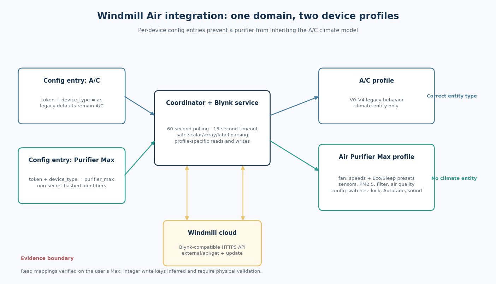

# Windmill Air Purifier Max + A/C: Integration Research and Implementation Report

**Date:** 2026-11-07  
**Integration version:** 1.1.0  
**Upstream baseline:** `bzellman/WindmillAC` commit `7da4372095b7b7536a4c77cdc61846ff4154d3d8`  
**Target:** Home Assistant Green, with separate A/C and Air Purifier Max config entries

# Executive Summary

The delivered integration resolves the entity-model problem by making device type an explicit property of each config entry. An entry configured as **Air conditioner** follows the legacy A/C coordinator path and creates only the original `climate` entity; an entry configured as **Air Purifier Max** follows a new purifier path and creates a `fan`, read-only sensors, and configuration switches. This is not merely a naming correction: Home Assistant’s entity contract explicitly assigns an air purifier fan to the fan platform, while manual speeds belong in percentage control and behavior modes belong in presets ([Home Assistant](https://contributors.home-assistant.io/core/entities/fan/)). The A/C and purifier therefore share transport code but not entity semantics, state parsing, or pin assumptions. Both devices can be added under the same integration domain with their own tokens, and old config entries without a device type continue to default to A/C.

The Air Purifier Max profile is based on two token-free, read-only capture sets supplied from the actual device rather than on the older WindmillFan mapping. Those captures establish power on V0, PM2.5 on V1, labeled main modes on V2, a numeric mirror on V3, sleep style on V4, accessory settings on V5/V6/V11, filter life on V7, probable Wi-Fi RSSI on V14, and qualitative air quality on V16. The targeted capture also resolves the original Sleep ambiguity: V2 remains `Sleep` and V3 remains `6` while V4 changes between `Whisper` and `White Noise`. The implementation consequently exposes **Sleep** as Sleep/Whisper and **White Noise** as Sleep/White Noise. Read mappings are hardware-evidenced, but physical writes were intentionally not attempted during diagnostics. Integer write keys remain an evidence-based inference from V3 and Blynk’s enumerable-datastream contract, so the package includes a mandatory manual write-test checklist rather than claiming end-to-end hardware verification ([Blynk](https://docs.blynk.io/en/blynk.console/templates/datastreams/datastreams-common-settings)).

## 1. Root Cause and Design Decision

The upstream integration was designed around one appliance category. Its documentation describes creating a climate entity for Windmill A/C units, and the baseline implementation forwards the climate platform and interprets V0–V4 using A/C meanings ([WindmillAC](https://github.com/bzellman/WindmillAC)). When a purifier token is entered into that design, the integration does not discover the appliance and negotiate a suitable representation; it simply runs the same A/C reads and constructs the same climate entity. A purifier can therefore appear to be an air conditioner even when some values happen to overlap electrically. Reusing that model would produce incorrect controls, misleading state, and potentially unsafe writes because a pin that means target temperature or A/C fan mode in one profile can mean an unrelated purifier setting in another.

The selected design keeps one integration domain but introduces an explicit `device_type` field in every new config entry. Setup creates one coordinator per entry and passes the selected type into it; the coordinator then dispatches to either the unchanged A/C data routine or the purifier routine. Platform setup functions independently decide whether to add entities, so `climate.py` returns immediately for a purifier and the purifier platforms return immediately for an A/C. This separation is preferable to maintaining two unrelated integrations because HTTP transport, timeouts, response parsing, update timing, and token-safe logging remain shared. It is also preferable to auto-detection because the public evidence did not provide a reliable model-discovery endpoint, while the user can select the correct type with certainty during setup.

| Design element | Upstream baseline | Delivered integration |
| --- | --- | --- |
| Device selection | Token only; the integration is documented as an A/C climate connector ([WindmillAC](https://github.com/bzellman/WindmillAC)) | Token plus **Air conditioner** or **Air Purifier Max** |
| Polling profile | One A/C interpretation of V0–V4 | Explicit per-entry A/C or purifier dispatch |
| A/C representation | `climate` | Unchanged `climate`, with legacy unique IDs retained |
| Purifier representation | Incorrectly inherited `climate` | `fan`, sensors, and switches; no purifier `climate` |
| Multiple appliances | Multiple token entries, all treated as A/C | Separate typed entries under `windmillac` |
| Legacy entry behavior | No device-type field | Missing field defaults to A/C for backward compatibility |

## 2. Public Evidence and Related Work

Public material established the product capabilities and the relevant protocol rules, but it did not disclose a trustworthy Max pin map. Windmill’s purifier FAQ describes app monitoring of air quality, child lock, beeping, display controls, and purifier functions, and separately identifies PM2.5 tracking and Whisper sleep operation ([Windmill FAQ](https://support.windmillair.com/en-US/articles/purifier-faqs-197800)). Those capabilities guided the capture checklist, but marketing or support documentation cannot establish which virtual pin carries each value. The research therefore treated public product pages as feature evidence only, not as protocol evidence. This distinction prevented a plausible-looking but unsupported integration profile and explains why the final map comes from observed device state.

The related upstream issue reports a failure when another Windmill appliance is added to the A/C integration, including a missing-value error on V3 ([Issue #37](https://github.com/bzellman/WindmillAC/issues/37)). The associated WindmillFan fork demonstrates that a fan-entity adaptation is architecturally viable and documents five speeds—Whisper, Low, Medium, High, and Boost—mapped from 20% through 100% ([WindmillFan](https://github.com/markuswinkler/WindmillFan)). Its model is nevertheless not interchangeable with the Max evidence: the Max captures show four manual speeds, Eco and Sleep as main modes, and Whisper as a sleep style rather than a manual speed. The delivered implementation borrows the fan-platform conclusion but deliberately rejects the older five-speed map for this appliance.

## 3. Capture Method and Pin Evidence

### 3.1 Capture method

The diagnostic procedure used Blynk-compatible HTTPS reads against `https://dashboard.windmillair.com/external/api/get`, whose documented form accepts a device token and virtual pin ([Blynk](https://docs.blynk.io/en/blynk.cloud/device-https-api/get-datastream-value)). The utility prompts for the token with hidden terminal input, scans V0 through V40 after user-selected app states, and writes only response values and errors to JSON. It contains no call to the update endpoint. The resulting files contain no device token, account password, or dashboard identity. Raw user captures and the personal dashboard screenshot are excluded from the public repository; only the summarized, non-personal pin assignments are reproduced here. This design made the procedure safe to repeat without changing device state.

Seventeen general states established the main control and sensor map, followed by five targeted sleep states with six-second synchronization delays. The second procedure was necessary because an early observation suggested that V4 changed one prompt later than V2/V3, which was consistent with cloud/device propagation rather than a stable mode distinction. The targeted sequence compared a Low baseline, Sleep/Whisper, Sleep/White Noise, Whisper again, and a Low exit. This produced a clean repeated pattern instead of relying on a single transition. All statements in the pin table below refer to those private read-only observations, with the raw evidence intentionally left unpublished ([User capture](#31-capture-method)).

### 3.2 Capture-derived pin evidence

The captures support a narrow mapping policy: pins with observed, coherent state changes are candidates for entities, while unknown pins remain untouched. V2 supplies labels and V3 mirrors them numerically, so runtime reads use V2 for robust mode parsing while V3 serves as evidence for the corresponding integer keys. V14 showed negative values typical of RSSI, but the dashboard capture did not label it directly; it is therefore exposed only as an optional, disabled-by-default diagnostic sensor. No observed pin supplied a numeric AQI value. V16’s `Good` label is consequently modeled as qualitative **Air quality**, avoiding a fabricated numeric AQI sensor. The PM2.5 entity uses V1 in the purifier profile even though the legacy A/C profile uses that same pin for temperature.

| Pin | Observed values | Assigned meaning and implementation decision |
| --- | --- | --- |
| V0 | `0`, `1` | Purifier power; used by the main fan entity |
| V1 | `0` during supplied captures | PM2.5 numeric sensor, in µg/m³ |
| V2 | `Low`, `Medium`, `High`, `Boost`, `Eco`, `Sleep` | Main mode read; four manual speeds plus Eco/Sleep |
| V3 | `1`, `2`, `3`, `4`, `5`, `6` | Numeric mirror of Low through Sleep; evidence for writes, not polled at runtime |
| V4 | `Whisper`, `White Noise` | Sleep-style selector; combined with V2=Sleep in fan presets |
| V5 | `0`, `1` | Autofade configuration switch |
| V6 | `0`, `1` | Button sounds configuration switch |
| V7 | `99` | Filter life remaining, percent |
| V8 | `182` | Unknown; deliberately unmapped |
| V9, V10, V12 | `0` | Unknown; deliberately unmapped |
| V11 | `0`, `1` | Child lock configuration switch |
| V14 | `-52`, `-50` | Probable Wi-Fi RSSI in dBm; optional diagnostic sensor |
| V15 | `1` | Unknown; deliberately unmapped |
| V16 | `Good` | Qualitative air-quality text sensor; not numeric AQI |

The targeted sleep evidence is internally consistent across repeated transitions. In Sleep/Whisper and Sleep/White Noise, V2 is always `Sleep` and V3 is always `6`; only V4 changes between `Whisper` and `White Noise`. Exiting to Low returns V2/V3 to `Low`/`1` while the last sleep style can remain stored on V4. This means V4 is not a seventh main operating mode and Whisper is not equivalent to Low. The fan’s `preset_mode` therefore returns `Sleep` when V2=Sleep and V4=Whisper, returns `White Noise` when V2=Sleep and V4=White Noise, and ignores the stored V4 value while a manual or Eco main mode is active ([User capture](#31-capture-method)).

## 4. Home Assistant Entity Modeling

Home Assistant’s fan contract states that an air purifier fan belongs in a fan entity, that fixed manual speeds are represented through `speed_count` and percentages, and that named manual speeds are not presets ([Home Assistant](https://contributors.home-assistant.io/core/entities/fan/)). The implementation sets `speed_count = 4` and converts Low, Medium, High, and Boost to 25%, 50%, 75%, and 100%. Eco and the two sleep combinations are presets because they select device behavior rather than one of the four manual speeds. A percentage of zero turns the purifier off. Setting a manual speed writes only the main mode, which naturally ends an active Eco or Sleep preset instead of incorrectly preserving it as an independent option.

Sensors are read-only values and can report either numbers or text; signal-strength sensors belong in the diagnostic category ([Home Assistant](https://contributors.home-assistant.io/core/entities/sensor/)). Child lock, Autofade, and Button sounds are writable two-state settings, so they use switch entities with the configuration category rather than sensors or fan presets, consistent with the switch contract’s explicit examples of child lock and LED-indicator settings ([Home Assistant](https://contributors.home-assistant.io/core/entities/switch/)). All purifier entities share one `DeviceInfo`, one coordinator, and one non-secret device identifier. Entity properties read coordinator memory and perform no network I/O; writes call the service and then request one coordinator refresh. Their values are refreshed only through the coordinator.

| Home Assistant entity | Purifier state or action | Modeling rationale |
| --- | --- | --- |
| `fan` | Power, Low/Medium/High/Boost, Eco, Sleep, White Noise | Correct primary platform for an air purifier fan ([HA fan](https://contributors.home-assistant.io/core/entities/fan/)) |
| `sensor` PM2.5 | V1 numeric value | Numeric measurement with µg/m³ and PM2.5 device class |
| `sensor` Filter life remaining | V7 percentage | Read-only measurement, not a writable setting |
| `sensor` Air quality | V16 text such as `Good` | Qualitative text; no unsupported AQI device class |
| `sensor` Wi-Fi signal | V14 probable dBm | Diagnostic category and disabled by default due to lower certainty |
| `switch` Child lock | V11 on/off | Writable device configuration |
| `switch` Autofade | V5 on/off | Writable display-related configuration |
| `switch` Button sounds | V6 on/off | Writable sound configuration |

## 5. Implementation Architecture

The implementation adds a purifier-state helper for pure conversions, a shared purifier entity base, fan/sensor/switch platforms, and purifier-specific service methods. `const.py` is the single pin-profile authority; unknown pins are absent rather than assigned speculative meanings. The coordinator always requires power and mode, then polls each explicitly mapped optional pin inside its own error boundary. A failed PM2.5 or air-quality read becomes `None` without making power and speed control unavailable. This is especially important for a cloud API whose optional datastreams could vary by firmware, because primary control should not depend on every accessory measurement succeeding. Each entity remains small and profile-specific.

Transport parsing accepts JSON scalars, negative and floating-point numbers, arrays, and unquoted labels. Requests use a 15-second timeout and retain the existing executor-job model. Purifier writes target only known pins: V0 for power, V2 for main mode, V4 for sleep style, and V5/V6/V11 for accessory switches. Sleep and White Noise intentionally perform two ordered writes—main mode Sleep followed by the desired V4 style—before a single refresh. Blynk documents updates through `external/api/update` with a token, pin, and value ([Blynk](https://docs.blynk.io/en/blynk.cloud/device-https-api/update-datastream-value)). Enumerable datastreams communicate integer keys even when a dashboard displays labels, which is why the service sends numeric strings rather than `Low` or `White Noise` ([Blynk](https://docs.blynk.io/en/blynk.console/templates/datastreams/datastreams-common-settings)).

| Component | Responsibility | Important boundary |
| --- | --- | --- |
| `config_flow.py` | Token, device type, duplicate prevention, masked token input | Old entries without a type remain A/C |
| `coordinator.py` | Profile dispatch and polling | Optional purifier failures do not break primary control |
| `blynk_service.py` | HTTPS reads/writes and scalar/label parsing | No raw URL or response-body logging |
| `purifier_state.py` | Labels, integer keys, booleans, hashed identity | Rejects unsupported mode/style writes |
| `fan.py` | Percentage speeds and Eco/Sleep presets | Never creates a purifier climate entity |
| `sensor.py` | Numeric and qualitative read-only values | No invented numeric AQI |
| `switch.py` | Child lock, Autofade, Button sounds | Writes only explicitly configured pins |
| `purifier_entity.py` | Shared device metadata and availability | Raw token excluded from new identifiers |

## 6. Write-Key Confidence and Hardware Validation

The read captures directly support state interpretation, but a read-only diagnostic cannot prove that the device accepts a particular update. V2 write keys `1` through `6` have comparatively strong indirect support because V3 mirrors exactly those values in the same Low-through-Sleep order and Blynk defines enumerable labels as display representations of integer keys ([Blynk](https://docs.blynk.io/en/blynk.console/templates/datastreams/datastreams-common-settings)). V4’s `0`=Whisper and `1`=White Noise inference follows normal enum indexing but lacks a separate numeric mirror, so it carries more uncertainty. Boolean writes to V0, V5, V6, and V11 use `1`/`0`, matching their observed states. None of these write requests was sent to the physical purifier during research.

This evidence boundary is preserved in code comments, README warnings, and the validation checklist rather than hidden behind a “fully tested” claim. The simulated suite verifies that the integration constructs the intended requests—for example, Sleep produces V2=`6` and White Noise produces V4=`1`—but it cannot verify appliance firmware behavior. During first use, each control should be tested individually while observing the physical unit and Windmill app, allowing several seconds for synchronization. If any result differs, the correct response is to stop using that control and investigate the documented pin/type mismatch, not to probe unknown pins or send random values.

| Write | Implemented value | Evidence status | First-use check |
| --- | --- | --- | --- |
| Power V0 | `0` or `1` | Observed boolean read; physical write unverified | Device powers off/on and app agrees |
| Main mode V2 | Low=`1`, Medium=`2`, High=`3`, Boost=`4`, Eco=`5`, Sleep=`6` | Strong inference from V3 mirror; physical write unverified | Each requested mode matches device/app |
| Sleep style V4 | Whisper=`0`, White Noise=`1` | Inferred enum keys; physical write unverified | Sleep style changes without leaving Sleep |
| Autofade V5 | `0` or `1` | Observed boolean read; physical write unverified | Display behavior/app setting agrees |
| Button sounds V6 | `0` or `1` | Observed boolean read; physical write unverified | Audible behavior/app setting agrees |
| Child lock V11 | `0` or `1` | Observed boolean read; physical write unverified | Lock behavior/app setting agrees |

## 7. Security, Privacy, and Compatibility

The upstream security issue documents raw-token exposure through debug URLs, propagated request exceptions, and legacy A/C entity/device identifiers, as well as the absence of request timeouts ([Issue #43](https://github.com/bzellman/WindmillAC/issues/43)). The delivered service avoids logging full request URLs or response bodies, catches request exceptions without leaking their token-bearing context, and applies timeouts. New config-entry and purifier identifiers use the first 16 hexadecimal characters of a SHA-256 token hash, and the token field is masked in the configuration UI. The capture utility likewise uses hidden input and token-free output. These measures reduce accidental disclosure in logs, registries, diagnostics, and public documentation, although the cloud API still requires the token in each request URL as dictated by Blynk’s endpoint design.

Backward compatibility requires a deliberate exception for the legacy A/C entity. Changing its raw-token unique ID without a registry migration would break existing entity references, so the A/C implementation and identifiers remain unchanged. New purifier entities do not repeat that design. Users should nevertheless review legacy diagnostics and backups before sharing them, because old A/C registry identifiers may contain the token. Unknown purifier pins V8, V9, V10, V12, and V15 are neither polled nor written, and no account password is required by the integration or diagnostic tooling. Raw captures and personal dashboard images are not included in the GitHub-ready archive.

## 8. Validation Results and Remaining Limits

The final dependency-free suite contains **30 passing tests**. Coverage includes the unchanged legacy A/C read profile, the complete capture-derived purifier read profile, unknown-pin exclusion, optional-pin failure isolation, required-pin failure handling, all six main-mode conversions, both sleep styles, boolean parsing, non-secret identity, four manual percentages, Eco/Sleep/White Noise preset behavior, power-on sequencing, zero-percent shutdown, numeric and text sensors, all three switch pins, A/C platform isolation, integer-enum write construction, and token-safe logging. Syntax compilation, JSON parsing, and `git diff --check` are also part of final validation. These tests use Home Assistant stubs and simulated service responses; they do not contact the Windmill cloud or a real Home Assistant Green.

Several limits remain explicit. No real Home Assistant runtime installation has been performed in this environment, and no physical purifier write has been attempted. V14 is only a probable RSSI assignment and is therefore optional. V1 was observed as zero, so its pin role is supported by the dashboard/capture context but a nonzero particulate reading would provide a stronger operational comparison. No numeric AQI datastream was found, and the integration does not infer one from PM2.5 or `Good`. Finally, Windmill can change firmware or cloud datastream assignments without notice; the per-profile architecture isolates that risk, but it cannot eliminate the maintenance burden of an unofficial cloud integration.

| Validation layer | Result | What it does not prove |
| --- | --- | --- |
| Read-only hardware captures | Main controls and requested sensors mapped on one Max | Write acceptance or behavior on other firmware |
| 30 simulated tests | All passed in the final suite | Real Home Assistant runtime and cloud availability |
| Python compilation | Integration and tests compile | Platform-specific runtime compatibility |
| Manifest/HACS JSON parsing | Both integration and repository JSON files valid | GitHub Marketplace acceptance of a future public URL |
| Static whitespace validation | `git diff --check` passed | Functional hardware validation |
| Physical write checklist | Included in README and report | Must still be completed by the user |

## 9. Installation and Operational Guidance

The archive follows the public GitHub repository structure required by Marketplace/HACS: root-level `hacs.json` and `README.md`, with one integration under `custom_components/windmillac` ([Marketplace](https://contributors.home-assistant.io/marketplace/reference/repository-structure/)). After creating a public repository and uploading the extracted contents, replace `YOUR_GITHUB_USERNAME` in the manifest’s documentation and issue-tracker URLs. On Home Assistant 2026.11 or newer, add the repository through **Settings → Marketplace → Add from link**; custom repositories require a public GitHub repository and may require a GitHub connection ([Home Assistant](https://www.home-assistant.io/integrations/marketplace/#custom-repositories)). On 2026.10 or older, use HACS’s **Custom repositories** flow with the Integration category. Restart when replacing an existing `windmillac` installation so the new code is loaded.

Configuration must be performed twice: once with the A/C token and **Air conditioner**, then with the purifier token and **Air Purifier Max**. The expected result is one A/C `climate` entity and one purifier `fan` with its related sensors and switches, not two climate devices. Complete the physical write checklist before creating automations, especially for V4 sleep-style writes. Normal state updates are cloud-polled every 60 seconds, so app-originated changes can take until the next poll to appear. The package also supports manual copying into `/config/custom_components/windmillac` for users who prefer not to publish a repository, although Marketplace/HACS provides easier updates.

## 10. Conclusion

The completed patch treats the A/C and purifier as different appliances while preserving the useful shared transport and legacy A/C behavior. Its most important design choice is not the fan icon or the entity names, but the explicit per-entry profile boundary that prevents A/C pin semantics from reaching the purifier. The entity model follows Home Assistant’s platform contracts, the Max pin map follows actual read-only hardware evidence, and the Sleep/Whisper/White Noise distinction follows repeated targeted observations. Security improvements apply to new identifiers and shared request handling without silently migrating legacy A/C registry identities. That boundary also simplifies future firmware-specific fixes.

The remaining work is a bounded hardware-validation step, not another broad research or capture exercise. Install the GitHub-ready repository, configure both devices separately, and verify each requested action against the physical purifier and Windmill app. Until those writes are confirmed, the accurate status is **read mappings verified; write requests implemented and simulated; physical writes pending validation**. This wording should remain in public documentation until real-device results justify changing it. The integration is unofficial community software and is provided for general engineering use without a guarantee of compatibility with future Windmill firmware or cloud changes. Record any discrepancy with its pin and expected state.
